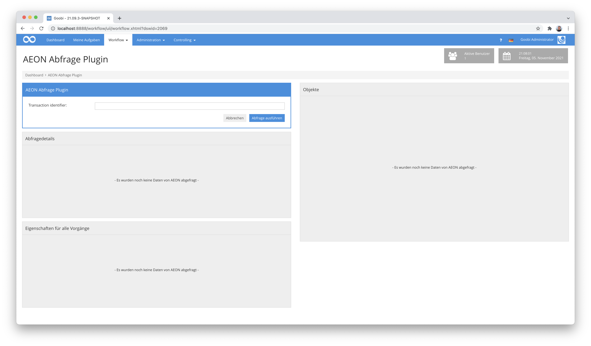
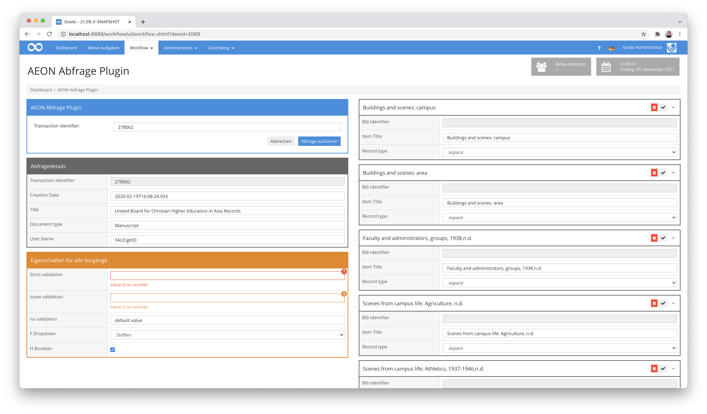
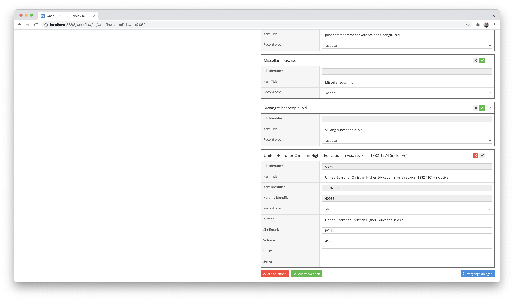
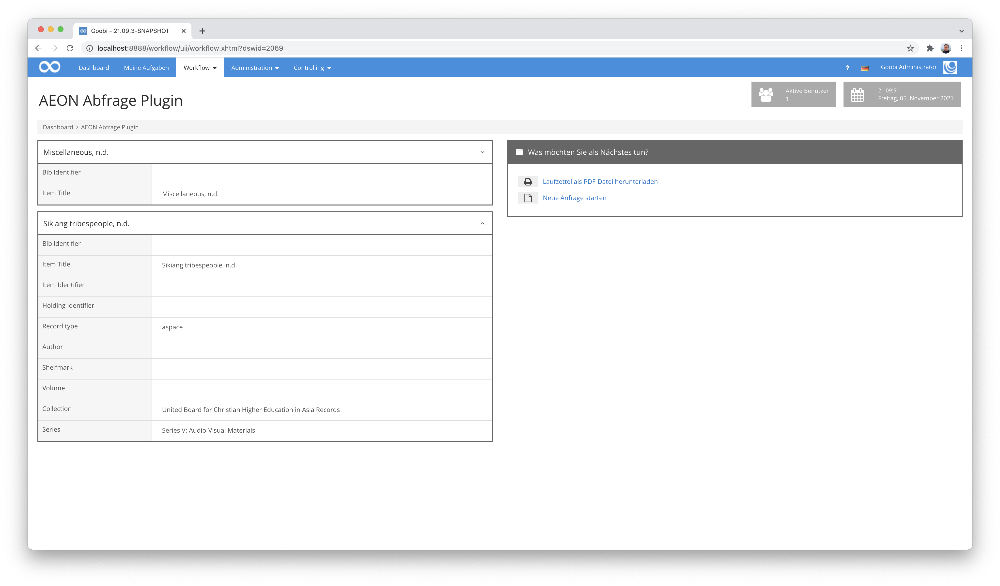

## Einführung
Mit diesem Plugin können einzelne Datensätze aus AEON abgefragt werden. Nachdem ein Datensatz abgefragt wurde, werden alle Metadaten aus der sog. Metadata Cloud abgefragt und aufgelistet. Der Nutzer kann anschließend auswählen, welche Datensätze er als Goobi-Vorgang anlegen möchte.


## Installation
Das Plugin besteht insgesamt aus den folgenden zu installierenden Dateien:

```bash
plugin-intranda-workflow-aeon-process-creation-base.jar
plugin-intranda-workflow-aeon-process-creation-gui.jar
plugin_intranda_workflow_aeon_process_creation.xml
```

Diese Dateien müssen in den richtigen Verzeichnissen installiert werden, so dass diese nach der Installation unter den folgenden Pfaden vorliegen:

```bash
/opt/digiverso/goobi/plugins/workflow/plugin-intranda-workflow-aeon-process-creation-base.jar
/opt/digiverso/goobi/plugins/GUI/plugin-intranda-workflow-aeon-process-creation-gui.jar
/opt/digiverso/goobi/config/plugin_intranda_workflow_aeon_process_creation.xml
```

Dieses Plugin verfügt über eine eigene Berechtigungsstufe für die Verwendung. Aus diesem Grund müssen Nutzer über die erforderlichen Rechte verfügen. Bitte weisen Sie daher der Benutzergruppe der entsprechenden Nutzer das folgende Recht zu:

```
Plugin_workflow_aeon_process_creation
```


## Überblick und Funktionsweise
Wenn der Nutzer über die Berechtigung zur Nutzung des Plugins verfügt, kann im Menüpunkt `Worklow` das Plugin `AEON Abfrage Plugin` geöffnet werden.



Hier kann nun ein Transaction identifier eingetragen werden, um die Suche nach einem AEON-Record zu starten.



Wenn eine erfolgreiche Suche durchgeführt wurde, wurde der Bereich `Abfragedetails` mit den Feldern gefüllt, die innerhalb der Konfiguration im Bereich `<transaction>` festgelegt wurden. Im Bereich `Eigenschaften für alle Vorgänge` werden die frei definierbaren Eigenschaften aus dem Konfigurationsbereich `<properties>` angezeigt.

Diese Felder lassen sich bearbeiten, sofern dies in der Konfigurationsdatei vorgesehen wurde. Verstöße gegen die Validierung werden unmittelbar bei den einzelnen Feldern angezeigt.

Im rechten Bereich der Nutzeroberfläche werden die einzelnen ermittelten Datensätze aufgelistet, die innerhalb der Metadata Cloud zu dem Barcode des AEON-Records gefunden wurden. Jede Box stellt hierbei einen eigenständigen Datensatz dar. Mehr Details eines Datensatzes lassen sich anzeigen, indem weitere Felder der Boxen ausgeklappt werden. Über die entsprechenden Icons pro Box lassen sich diejenigen Datensätze auswählen, für die Vorgänge in Goobi erzeugt werden sollen.



Sofern mindestens ein Datensatz ausgewählt wurde und keine unerfüllten strikten Validierungen vorliegen, lassen sich mittels Klick auf den Button `Vorgänge anlegen` die einzelnen Goobi-Vorgänge für die ausgewählten Datensätze auf der Basis der konfigurierten Produktionsvorlage anlegen. Anschließend gelangt der Nutzer somit auf eine weitere Ansicht.



Hier werden im linken Bereich noch einmal diejenigen Datensätze aufgeführt, für die Vorgänge in Goobi angelegt wurden. Im rechten Bereich steht die Möglichkeit zur Verfügung einen Laufzettel für alle erzeugten Vorgänge zu generieren und herunterzuladen, wo die zugehörigen Vorgänge alle innerhalb eines gemeinsamen Batches zusammengefasst aufgeführt werden.

Im linken Bereich werden außerdem die Vorgangstitel benannt. Vor dem Anlegen der Vorgänge wird im Modus für Batch-Vorgänge der einzelne Titel des Batch-Vorgangs gemäß `<processTitle>` angezeigt und kein Titel pro Datensatz, da die Datensätze eines Batches Strukturelemente dieses einen Vorgangs sind und keine eigenen Vorgänge. Wird für jeden Datensatz ein eigener Vorgang angelegt, endet jeder Titel bis zum Anlegen des Vorgangs auf `_…`; dies steht für die vierstellige Position seines Datensatzes unter den ausgewählten (`_0001`, `_0002`, …). Sobald die Vorgänge existieren, werden die tatsächlichen Titel angezeigt.


## Batch-Erstellung

Im Batch-Modus erzeugt dieses Plugin einen einzigen Vorgang für die Anfrage. Dessen METS-Datei enthält die Transaktionsfelder am Wurzel-Strukturelement und pro ausgewähltem Datensatz ein Kind-Strukturelement mit den Katalogdaten dieses Datensatzes und denjenigen seiner Felder, die als Metadaten gespeichert werden.

Jeder Datensatz des Batches wird durch einen Datensatzschlüssel gekennzeichnet: den Transaktionsidentifikator, gefolgt von der vierstelligen Position des Datensatzes unter den ausgewählten; der zweite Datensatz der Transaktion `286670` hat also den Schlüssel `286670_0002`. Durch die Transaktion ist der Schlüssel über alle Vorgänge hinweg eindeutig. Der Schlüssel wird an zwei Stellen geschrieben:

* auf das Kind-Strukturelement des Datensatzes, in das unter `<childKeyMetadata>` genannte Metadatenfeld,
* vor den Namen jeder Vorgangseigenschaft, die zu dem Datensatz gehört, als `<Datensatzschlüssel>_<Eigenschaftsname>`, zum Beispiel `286670_0002_Bib ID`.

Weitere Schritte des Workflows können anhand des Schlüssels erkennen, welche Eigenschaften des Batch-Vorgangs zu welchem seiner Datensätze gehören.

> **Hinweis zur Aktualisierung:** Die Datensatzschlüssel stammten bisher aus einem Zähler, den sich alle Vorgänge in Goobi teilen, sodass die Datensätze eines Batches als `0473`, `0474` usw. nummeriert wurden, im Anschluss an die vorige Anfrage. Sie werden jetzt wie oben beschrieben je Anfrage nummeriert, und Vorgänge erhalten keine Eigenschaft `OrderNumber` mehr. Früher erzeugte Batches behalten ihre alten Schlüssel in ihren Metadaten und Eigenschaftsnamen.

> **Hinweis zur Aktualisierung:** `<batchTitleSuffix>` und `<homeSiteField>` werden durch `<processTitle>` ersetzt. Der bisherige Standardtitel entspricht `<processTitle>{Transaction Identifier}_{Home site}_group</processTitle>` zusammen mit einem `<transaction>`-Feld mit dem Titel `Home site`, das `customFieldValues/HomeSite` liest - mit dem Unterschied, dass ein leerer Home Site die Anfrage jetzt anhält, statt zu `unknown` zu werden. Eine Konfiguration, die noch `<batchTitleSuffix>` enthält oder in der `<processTitle>` fehlt, wird als Fehler gemeldet, und es wird kein Vorgang angelegt, bis sie korrigiert ist. `<homeSiteField>` wird einfach ignoriert.

> **Hinweis zur Aktualisierung:** `<processTitleMetadata>` wird nicht mehr gelesen. Die Eigenschaften eines Batches trugen bisher einen für jeden Datensatz vorab berechneten Titel als Präfix; jetzt tragen sie den Datensatzschlüssel. Früher erzeugte Batches behalten ihre alten Eigenschaftsnamen.


## Konfiguration
Die Konfiguration des Plugins erfolgt über die Konfigurationsdatei `plugin_intranda_workflow_aeon_process_creation.xml` und kann im laufenden Betrieb angepasst werden. Im folgenden ist eine beispielhafte Konfigurationsdatei aufgeführt:

```xml
<config_plugin>
    <aeon>
        <url>https://example.com/api</url>
        <apiKey>1234567890</apiKey>
        <username>username</username>
        <password>password</password>
    </aeon>

    <processCreation>
        <workflowName>digitisation on demand</workflowName>
        <opacName>Metadata cloud</opacName>
        <processTitle>{Transaction Identifier}_group</processTitle>
    </processCreation>

    <transaction>
        <field aeon="transactionNumber">
            <title>Transaction Identifier</title>
            <type readonly="true">input</type>
            <variable place="process">Transaction Identifier</variable>
            <help>This is my description for the field so that everyone gets some help.</help>
            <validation strict="true">\d+</validation>
            <message>Your content does not follow our validation guidelines</message>
        </field>

        <field aeon="creationDate">
            <title>Creation Date</title>
            <type readonly="false">input</type>
            <variable place="process">Creation date</variable>
            <help>This is my description for the field so that everyone gets some help.</help>
            <message>Your content does not follow our validation guidelines</message>
        </field>

        <field aeon="itemTitle">
            <title>Title</title>
            <type readonly="false">input</type>
            <variable place="process">Main title</variable>
            <value>Transmission</value>
            <help>This is my description for the field so that everyone gets some help.</help>
        </field>

        <field aeon="documentType">
            <title>Document type</title>
            <type readonly="false">input</type>
            <variable place="process">Doc type</variable>
            <help>This is my description for the field so that everyone gets some help.</help>
        </field>

        <field aeon="username">
            <title>User Name</title>
            <type readonly="false">input</type>
            <variable place="process">User</variable>
            <help>This is my description for the field so that everyone gets some help.</help>
        </field>
    </transaction>

    <properties>
        <field>
            <title>Strict validation example</title>
            <type readonly="false">input</type>
            <variable place="process">Strict field</variable>
            <value>no numeric value</value>            
            <help>This is my description for the field so that everyone gets some help.</help>
            <validation strict="true">\d+</validation>
            <message>Value is no number</message>
        </field>

        <field>
            <title>Loose validation example</title>
            <type readonly="false">input</type>
            <variable place="process">Loose field</variable>
            <value>no numeric value</value>
            <help>This is my description for the field so that everyone gets some help.</help>
            <validation strict="false">\d+</validation>
            <message>Value is no number</message>
        </field>

        <field>
            <title>no validation example</title>
            <type readonly="false">input</type>
            <variable place="process">Text field</variable>
            <value>default value</value>
            <help>This is my description for the field so that everyone gets some help.</help>
            <message>Your content does not follow our validation guidelines</message>
        </field>
        <field>
            <title>Dropdown example</title>
            <type readonly="false">select</type>
            <variable place="work">CoWorker</variable>
            <value>Steffen</value>
            <select>Steffen</select>
            <select>Oliver</select>
            <select>Robert</select>
            <help>This is my description for the field so that everyone gets some help.</help>
        </field>

        <field>
            <title>Vocabulary example</title>
            <type readonly="false">vocabulary</type>
            <variable place="work">Vocabulary</variable>
            <vocabularyName>Subject terms</vocabularyName>
            <vocabularyField>type=Person</vocabularyField>
            <help>This is my description for the field so that everyone gets some help.</help>
        </field>
        <field>
            <title>Boolean example</title>
            <type readonly="false">checkbox</type>
            <variable place="process">Status</variable>
            <value>true</value>
            <help>This is my description for the field so that everyone gets some help.</help>
        </field>
    </properties>

    <processes>
        <field aeon="bibId" displayAlways="true" displayInTitle="false">
            <title>Bib Identifier</title>
            <type readonly="true">input</type>
            <variable place="process">Text field</variable>
            <help>This is my description for the field so that everyone gets some help.</help>
        </field>
        <field aeon="title" displayAlways="true" displayInTitle="true">
            <title>Item Title</title>
            <type readonly="false">input</type>
            <variable place="process">Text field</variable>
            <help>This is my description for the field so that everyone gets some help.</help>
        </field>
        <field aeon="itemId" displayAlways="false" displayInTitle="false">
            <title>Item Identifier</title>
            <type readonly="true">input</type>
            <variable place="process">Text field</variable>
            <help>This is my description for the field so that everyone gets some help.</help>
        </field>
            <field aeon="holdingId" displayAlways="false" displayInTitle="false">
            <title>Holding Identifier</title>
            <type readonly="true">input</type>
            <variable place="process">Text field</variable>
            <help>This is my description for the field so that everyone gets some help.</help>
        </field>
        <field aeon="recordType" displayAlways="false" displayInTitle="false">
            <title>Record type</title>
            <type readonly="false">select</type>
            <variable place="work">publication</variable>
            <select>ils</select>
            <select>aspace</select>
            <help>This is my description for the field so that everyone gets some help.</help>
        </field>
        <field aeon="collection" displayAlways="false" displayInTitle="false">
            <title>Collection</title>
            <type readonly="false">input</type>
            <variable place="work">Text field</variable>
            <help>This is my description for the field so that everyone gets some help.</help>
        </field>
    </processes>
</config_plugin>
```

Innerhalb des Bereiches `<aeon>` werden die Zugangsdaten verwaltet. Hier müssen die URL zur RESTful API von AEON sowie Nutzername und Passwort hinterlegt werden. Soll alternativ ein Key für die Verwendung der API genutzt werden muss dieser angegeben werden.

Im Block `<processCreation>` kann definiert werden, welche OPAC-Konfiguration zur Anfrage von Katalogdaten genutzt werden soll und auf Basis welcher Produktionsvorlage die einzelnen Vorgänge erzeugt werden sollen.

`opacName` muss einen Katalog genau so benennen, wie Goobi ihn dem in `defaultWorkflowName` genannten Workflow anbietet; der Vergleich unterscheidet Groß- und Kleinschreibung. Welche Namen das sind, entscheidet nicht eine einzelne Datei: `goobi_opac.xml` benennt die Kataloge, ein vom JSON-OPAC-Plugin bereitgestellter Katalog erscheint jedoch unter dem `name`-Attribut des jeweiligen `<config>` in `plugin_intranda_opac_json.xml`, und dieses Plugin kann je Workflow andere anbieten. Ein Name, der zu keinem davon passt, wird als Fehler gemeldet, der die tatsächlich vorhandenen Kataloge nennt, und die Anfrage bricht ab. Der Katalog muss zudem vom JSON-OPAC-Plugin bereitgestellt werden, da die Datensätze als JSON gelesen werden; ein von einem anderen OPAC-Plugin bereitgestellter Katalog wird ebenfalls gemeldet und bricht die Anfrage ab.

Zwei seiner Parameter benennen AEON-Felder und keine Goobi-Einstellungen:

Parameter           |  Erläuterung
------------------- | -----------------------------------------------------
`materialTypeField` | Name des AEON-Feldes, das den Materialtyp enthält. Sein Wert wird mit dem Attribut `type` der Felder in `<properties>` verglichen und entscheidet damit, welche Eigenschaften angezeigt und validiert werden. Standardmäßig leer, da AEON keinen Materialtyp mehr liefert: es gilt dann kein auf einen Materialtyp beschränktes Feld, sodass die erzeugten Vorgänge allein die unbeschränkten Eigenschaften tragen, und es wird nichts gemeldet - das ist das beabsichtigte Verhalten und kein Fehler. Der Parameter ist nur dort zu setzen, wo AEON einen Materialtyp liefert; ein hier benanntes, von AEON aber leer gelassenes Feld wird als Hinweis gemeldet und die Anfrage fortgesetzt.
`transactionNumberField` | Name des AEON-Feldes, das die Transaktionsnummer enthält. Enthält der AEON-Record keine Transaktionsnummer, wird die Anfrage mit einer Fehlermeldung abgewiesen, da eine Anfrage ohne sie bei erneutem Senden nicht wiedererkannt werden könnte. Standardwert: `transactionNumber`.
`usernameField`     | Optional. Name des AEON-Feldes, das den Benutzernamen des Patrons enthält, zum Beispiel `username`. Ist er gesetzt, werden damit Nachname und Mailadresse am AEON-Endpunkt `Users` nachgeschlagen, die Felder mit `aeon="lastName"` oder `aeon="eMailAddress"` dann auslesen können. Standardmäßig nicht gesetzt, sodass keine Abfrage stattfindet.
`referenceNumberField` | Name des AEON-Feldes, das den Barcode enthält, mit dem der konfigurierte Katalog abgefragt wird. Standardwert: `referenceNumber`.
`defaultWorkflowName` | Titel der Produktionsvorlage, die auf der Anfrageseite vorausgewählt ist, sowohl bevor eine Anfrage geladen wurde als auch danach. Gibt es keine Vorlage mit diesem Titel, wird stattdessen die dem Titel nach erste Vorlage vorausgewählt. Vor dem Anlegen der Vorgänge kann eine andere Vorlage gewählt werden.
`workflowName` | Optional und wiederholbar. Eine Produktionsvorlage für einen Materialtyp, der im Attribut `type` genannt wird, zum Beispiel `<workflowName type="Audio Recording (DRMS)">Audio files</workflowName>`. Sobald eine Anfrage mit diesem Materialtyp geladen ist, ersetzt diese Vorlage den Standard in der Vorauswahl. Ein Eintrag, der eine nicht vorhandene Vorlage nennt, wird ignoriert. Ohne Materialtyp greift kein Eintrag, auch keiner ohne `type`-Attribut.
`processTitle`      | Pflichtangabe. Titel des erzeugten Vorgangs: fester Text mit Platzhaltern in geschweiften Klammern, die jeweils ein Feld aus `<transaction>` oder `<properties>` über seinen `<title>` benennen, zum Beispiel `{Transaction Identifier}_{Home site}_group`. Ein Platzhalter steht für den Wert, den das Feld beim Anlegen der Vorgänge hat, also einschließlich der Eingaben des Bearbeiters. In den Werten werden Zeichen, die Goobi in Vorgangstiteln nicht erlaubt, durch einen Unterstrich ersetzt; der feste Text bleibt wie angegeben. Ist ein referenziertes Feld leer, wird nichts angelegt und die leeren Felder werden genannt; ein Eigenschaftsfeld, das für den Materialtyp der Anfrage nicht gilt, zählt als leer. Jedes leere Feld, das der Titel benötigt, wird in der Anfrage mit *Wird für den Vorgangstitel benötigt* markiert, bis es ausgefüllt ist. Ein Batch-Titel, den bereits ein anderer Vorgang trägt, wird ebenfalls abgewiesen. Ein Platzhalter, der kein Feld benennt, oder unvollständige Klammern werden als Konfigurationsfehler gemeldet. Vorgänge, die einzeln pro Datensatz angelegt werden, erhalten zusätzlich die vierstellige Position ihres Datensatzes unter den ausgewählten, `_0001`, `_0002` usw. Da sich diese Nummern in jeder Anfrage wiederholen, sind solche Titel nur eindeutig, wenn die Vorlage etwas für die Anfrage Eindeutiges enthält, etwa den Transaktionsidentifikator; jeder von ihnen wird vor dem Anlegen mit den vorhandenen Vorgängen abgeglichen.
`allowMultiProcessCreation` | Veraltete Option. Mit `true` wird auf der Anfrageseite die Wahl zwischen der Batch-Erstellung und dem Anlegen eines Vorgangs pro Datensatz angeboten. Standardwert `false`: die Auswahl ist ausgeblendet und das Plugin legt immer einen Batch-Vorgang an.
`childKeyMetadata`  | Name des Metadatenfeldes, das auf jedes Kind-Strukturelement eines Batches geschrieben wird und dessen Datensatzschlüssel erhält, zum Beispiel `286670_0001`, wie unter *Batch-Erstellung* beschrieben. Der Metadatentyp muss im Regelsatz vorhanden und für die Kind-Docstruct-Typen zugelassen sein.

Alle akzeptieren einen mit Schrägstrichen getrennten Pfad, um ein Feld innerhalb einer verschachtelten Map anzusprechen. Ältere AEON-Versionen hielten den Materialtyp im flachen Feld `shippingOption`, was als `<materialTypeField>shippingOption</materialTypeField>` zu konfigurieren wäre.

Zusätzlich zur Anfrage selbst werden ihre Notizen am AEON-Endpunkt `Requests/[transactionNumber]/notes` abgefragt. Die Notizen vom Typ `User` und `Staff` stehen danach unter `aeon="notes"` zur Verfügung, eine Zeile pro Notiz in der Form `noteDate username: noteText`, die älteste zuerst, zum Beispiel `2025-08-07T22:32:35.327Z Researcher: Please digitize years 1888-1890`. Notizen vom Typ `System` und `ItemDetail` werden nicht übernommen. Schlägt die Abfrage fehl, wird dies als Hinweis gemeldet und die Anfrage ohne Notizen fortgesetzt.

Anschließend erfolgt die Konfiguration der angezeigten und importierbaren Felder. Dies ist in 3 Bereiche aufgeteilt. Der Bereich `<transaction>` enthält diejenigen Felder, die aus dem AEON-Record gelesen werden. Der Bereich `<properties>` enthält frei definierbare Eigenschaften, die zu den zu erzeugenden Vorgängen gehören. Und der Bereich `<processes>` enthält die Felder, die bei der Abfrage der Daten aus der Metadata Cloud bezogen wurden.

Die Konfiguration innerhalb der drei Bereiche ist annähernd identisch. Jedes Feld wird jeweils durch ein  Element `<field>` definiert. Innerhalb davon sind anschließend folgende Möglichkeiten vorgesehen:

Parameter           |  Erläuterung
------------------- | -----------------------------------------------------
`title`             | Anzeigename des Feldes
`type`              | Typ des Feldes, mögliche Werte sind `input` (Textfeld), `textarea` (mehrzeiliges Textfeld, etwa für `aeon="notes"`), `select` (Auswahlfeld), `vocabulary` (Auswahlfeld aus einem Vokabular), `checkbox` (Checkbox), `input-dont-overwrite` (Textfeld, das im linken Bereich editierbar ist, aber nicht im rechten Bereich), `radio-dont-overwrite` (Radio-Buttons, die im linken Bereich editierbar sind, aber nicht im rechten Bereich)
`readonly`          | Die Werte `true` oder `false` definieren, ob der Inhalt des Feldes bearbeitet werden darf.
`aeon`              | Name des json Elements, aus dem das Feld befüllt wird. Ein mit Schrägstrichen getrennter Pfad spricht ein Element innerhalb einer verschachtelten Map an, zum Beispiel `customFieldValues/MaterialType`. Dieser Parameter wird für die frei definierbare Eigenschaften nicht ausgewertet.
`displayAlways`     | Die Werte `true` oder `false` definieren, ob das Feld angezeigt wird, wenn nur ein minimierter Datensatz angezeigt wird. Dieser Parameter wird ausschließlich für die Felder aus der Metadata Cloud ausgewertet.
`displayInTitle`    | Die Werte `true` oder `false` definieren, ob das Feld innerhalb der Kopfzeile der Box aufgeführt wird. Dieser Parameter wird ausschließlich für die Felder aus der Metadata Cloud ausgewertet.
`variable`          | Dieser Parameter definiert den Namen der zu erstellenden Eigenschaft. Dieser Parameter wird für Daten aus der Metadata Cloud nicht ausgewertet.
`place`             | Legt fest, wo der Wert gespeichert wird. `metadata` schreibt ein Metadatum in die METS-Datei; `variable` ist dann der Name eines Metadatentyps, den der Regelsatz des Workflows definieren muss und der am Dokumentstrukturtyp des Datensatzes erlaubt sein muss. `process` schreibt eine Goobi-Vorgangseigenschaft, `variable` ist dann der Name der Eigenschaft. Voreinstellung ist `process`. `work` und `template` werden aus Kompatibilitätsgründen weiterhin akzeptiert und verhalten sich wie `process`; die damit benannten Werkstück- und Vorlageneigenschaften wurden nie umgesetzt.
`value`             | Mit diesem Parameter kann ein Default Wert festgelegt werden. Falls ein AEON Element konfiguriert und durch die Abfrage erhalten wurde, wird der konfigurierte default Wert mit dem Inhalt aus AEON überschrieben.
`help`              | Mit diesem Parameter lässt sich ein Hilfetext definieren der optional angezeigt werden kann.
`validation`        | Dieser Parameter definiert einen regulären Ausdruck, gegen den der Feldinhalt validiert werden kann.
`strict`            | Die Werte `true` oder `false` definieren, ob ein Verstoß gegen die Validierung zwingend behoben werden muss, bevor Vorgänge angelegt werden können.
`message`           | Dieser Parameter legt eine Meldung fest, die im Falle von Validierungsfehlern angezeigt werden soll.
`vocabularyName`    | Dieser Parameter definiert ein zu nutzendes Vokabular.
`vocabularyField`   | Mit dem Parameter `fieldname=value` kann das Trefferset auf Werte eingeschränkt werden, die diese Definition erfüllen. Das Feld ist wiederholbar, um mehrere Einschränkungen gleichzeitig zu definieren.

### Werte als Metadaten speichern

Ein Feld, das mit `place="metadata"` konfiguriert ist, wird in die METS-Datei des Vorgangs geschrieben,
anstatt zu einer Vorgangseigenschaft zu werden. Sein `variable` benennt einen Metadatentyp, den der
Regelsatz des gewählten Workflows definieren muss und der am Dokumentstrukturtyp erlaubt sein muss, als
der der Datensatz importiert wird. Fehlt eines von beidem, bricht die Vorgangserstellung mit einer
Fehlermeldung ab und legt nichts an, statt einen Vorgang zu erzeugen, bei dem ein Teil der Daten
stillschweigend fehlt.

Die Wahl des Speicherorts richtet sich danach, was der Wert ist. Katalog- und Transaktionsdaten
beschreiben das Objekt und gehören in die METS-Datei. Werte, die den Workflow steuern - Ausgabeformate,
OCR-Optionen, der Patronentyp - sind Jobparameter und bleiben Vorgangseigenschaften, wo sie auf den
Aufgabenbildschirmen angezeigt und bearbeitet werden können.

**Metadaten werden exportiert, Eigenschaften nicht.** METS-Dateien werden beim Export an den Viewer
oder das DMS weitergegeben, daher dürfen Patronennamen oder andere personenbezogene Daten nicht als
Metadaten konfiguriert werden.

**Ein als Metadatum geschriebenes `multiselect`-Feld erzeugt ein Metadatum pro ausgewähltem Wert.** Ist
der Metadatentyp im Regelsatz mit `num="1o"` oder einer anderen Einstellung definiert, die ihn auf ein
einziges Vorkommen beschränkt, wirft der zweite ausgewählte Wert eine Exception, die die gesamte Anfrage
abbricht; das wird vorher an keiner Stelle geprüft. Ein `multiselect`-Feld mit `place="metadata"`
braucht deshalb einen Metadatentyp, der Wiederholung erlaubt (`num="*"`).

Dieselbe Kollision kann auch bei zwei völlig unterschiedlichen Feldern auftreten: Zwei Felder, die mit
demselben Metadatentyp konfiguriert sind, werden im Einzelvorgangs-Modus beide auf denselben
Dokumentstruktur-Knoten geschrieben. Daher entweder unterschiedliche Typnamen vergeben oder den Typ im
Regelsatz mit `num="*"` deklarieren.

Die Transaktionsnummer ist ein Sonderfall: Sie muss mit `place="metadata"` konfiguriert werden.
`<processCancellation><transactionFieldName>` ist optional; ist es vorhanden, muss es genau denselben
`variable`-Wert tragen, und fehlt es, leitet das Plugin denselben Namen selbstständig aus der
`variable` des Transaktionsnummernfeldes ab. Sowohl die Dublettenprüfung als auch die Prozesssuche
schlagen die Transaktionsnummer im Metadatenindex von Goobi nach, und eine Abweichung würde dazu
führen, dass beide nichts finden. Das Plugin verweigert die Vorgangserstellung, wenn der konfigurierte
Name und die Variable nicht übereinstimmen.

Zwei Einschränkungen sollte man kennen, bevor eine bestehende Installation umgestellt wird:

* **Vorgänge, die vor der Umstellung angelegt wurden, tragen Eigenschaften und keine Metadaten.** Die
  Dublettenprüfung und die Prozesssuche finden sie nicht, sodass eine erneut angefragte alte Transaktion
  nicht als Dublette gemeldet wird und ein alter Vorgang nicht über das Plugin storniert werden kann.
* **Datensätze werden über ihren Identifier als Duplikat erkannt, nicht über den Vorgangstitel.** Ein
  Datensatz gilt als bereits digitalisiert, wenn ein Vorgang seine `uri` (ArchivesSpace) bzw. seine
  `bibId` und `volume` (ILS) trägt, in dem Speicher, für den diese `<processes>`-Felder konfiguriert
  sind. Das gilt über alle Transaktionen hinweg, nicht nur für die aktuelle. Ein Datensatz
  innerhalb eines Batch-Vorgangs wird aus dem im nächsten Punkt genannten Grund nicht gefunden.
* **Im Batch-Modus sind Metadaten je Datensatz nicht durchsuchbar.** Die Werte jedes Datensatzes werden
  auf den Dokumentstruktur-Knoten dieses Datensatzes geschrieben, der ein Kind des Batch-Objekts ist.
  Goobi indiziert nur den obersten Dokumentstruktur-Knoten, und `$(meta....)` löst nur gegen die oberste
  Ebene und das erste Kind auf. Die Datensatz-Metadaten sind in der METS-Datei vorhanden, können aber
  nicht durchsucht oder in Skripten verwendet werden. Die Transaktionsfelder liegen auf der Batch-Wurzel
  und sind davon nicht betroffen.
