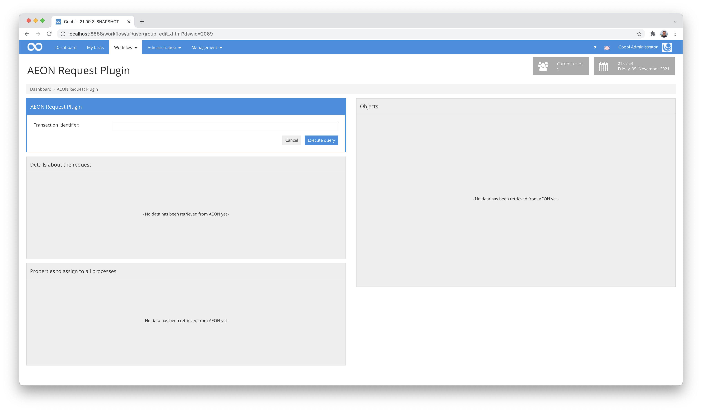
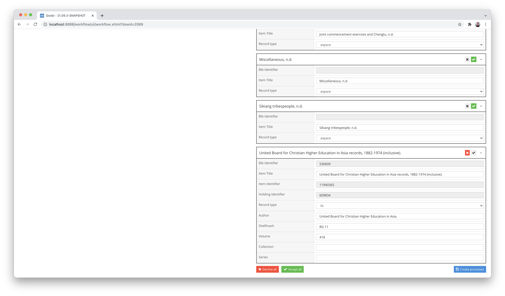
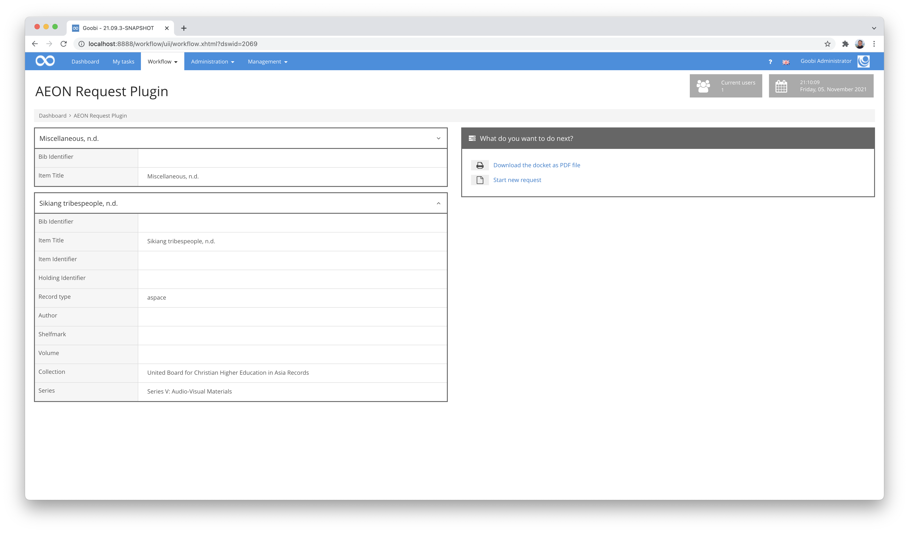

## Introduction
This plugin can be used to query individual data sets from AEON. After a record has been queried, all metadata from the so-called Metadata Cloud are retrieved and listed. The user can then select which data sets he or she would like to create as a Goobi operation.


## Installation
The plug-in consists of the following files to be installed:

```bash
plugin-intranda-workflow-aeon-process-creation-base.jar
plugin-intranda-workflow-aeon-process-creation-gui.jar
plugin_intranda_workflow_aeon_process_creation.xml
```

These files must be installed in the correct directories so that they are available under the following paths after installation:

```bash
/opt/digiverso/goobi/plugins/workflow/plugin-intranda-workflow-aeon-process-creation-base.jar
/opt/digiverso/goobi/plugins/GUI/plugin-intranda-workflow-aeon-process-creation-gui.jar
/opt/digiverso/goobi/config/plugin_intranda_workflow_aeon_process_creation.xml
```

This plugin has its own permission level for use. For this reason, users must have the required permissions. Therefore, please assign the following right to the user group of the corresponding users:

```
Plugin_workflow_aeon_process_creation
```


## Overview and functionality
If the user has the authorisation to use the plugin, the plugin `AEON Query Plugin` can be opened in the menu item `Workflow`.



A transaction identifier can now be entered here to start the search for an AEON record.


If a successful search was performed, the `query details` area was filled with the fields that were defined within the configuration in the `<transaction>` area. In the area `Properties for all transactions` the freely definable properties from the configuration area `<properties>` are displayed.

These fields can be edited if this has been provided for in the configuration file. Violations of the validation are displayed directly next to the individual fields.

In the right-hand area of the user interface, the individual data records found within the Metadata Cloud for the barcode of the AEON record are listed. Each box represents an independent data record. More details of a data record can be displayed by expanding further fields of the boxes. The corresponding icons per box can be used to select the data sets for which processes are to be generated in Goobi.



Provided at least one record has been selected and there are no unfulfilled strict validations, clicking on the `Create processes` button allows the user to create the individual Goobi processes for the selected records based on the configured process template. This then takes the user to another view.



The left-hand pane lists the records for which processes have been created in Goobi. The right-hand pane offers the option of generating and downloading a docket for all created processes, where the associated processes are all listed together within a common batch.

The left-hand pane also names the process titles. Before the processes are created it shows, in batch creation mode, the single title of the batch process including its `<batchTitleSuffix>`, and no title per record: the child processes the batch is later split into are not named here, because their titles are only composed at split time. Where a process is created for each record, each title ends in `_…` as a placeholder for the order number, which is only drawn when the process is created. Once the processes exist, the actual titles are shown.


## Handover to the split processes plugin

In batch creation mode this plugin creates one process containing a child structure element per selected record, which the step plugin `intranda_step_split_processes` later splits into one process per child.

The child process titles are **not** decided here. They are composed at split time from configured title parts, because the metadata they are based on is only fetched into the batch's METS file and is not available when the batch is created.

What this plugin does provide is the link between them: every child structure element receives its order number in the metadata field named by `<childKeyMetadata>`, and the properties of the batch process are named `<orderNumber>_<propertyName>`. The split plugin reads that key off each child and uses it to decide which properties belong to which child process.

Both plugins must therefore be configured consistently:

| AEON | split processes |
|------|-----------------|
| `<childKeyMetadata>_OrderNumber</childKeyMetadata>` | `<childKeyMetadata>_OrderNumber</childKeyMetadata>` |
| `<batchTitleSuffix>_group</batchTitleSuffix>` | `<title name="{parent}" strip="_group"/>` |

Neither plugin can validate the other's configuration.

> **Upgrade note:** this version replaces the earlier `<processTitleMetadata>`, which wrote a predicted child process title. The two plugins must be deployed together, at a moment when no batch is waiting to be split. A batch created by the earlier version carries property names prefixed with the predicted title, which the new split plugin does not look for, and its properties would silently fail to copy.


## Configuration
The plugin is configured via the configuration file `plugin_intranda_workflow_aeon_process_creation.xml` and can be adapted during operation. The following is an example configuration file:

```xml
<config_plugin>
    <aeon>
        <url>https://example.com/api</url>
        <apiKey>1234567890</apiKey>
        <username>username</username>
        <password>password</password>
    </aeon>

    <processCreation>
        <workflowName>digitisation on demand</workflowName>
        <opacName>metadata cloud</opacName>
        <homeSiteField>customFieldValues/HomeSite</homeSiteField>
    </processCreation>

    <transaction>
        <field aeon="transactionNumber">
            <title>Transaction Identifier</title>
            <type readonly="true">input</type>
            <variable place="process">Transaction Identifier</variable>
            <help>This is my description for the field so that everyone gets some help.</help>
            <validation strict="true">\d+</validation>
            <message>Your content does not follow our validation guidelines</message>
        </field>

        <field aeon="creationDate">
            <title>Creation Date</title>
            <type readonly="false">input</type>
            <variable place="process">Creation date</variable>
            <help>This is my description for the field so that everyone gets some help.</help>
            <message>Your content does not follow our validation guidelines</message>
        </field>

        <field aeon="itemTitle">
            <title>Title</title>
            <type readonly="false">input</type>
            <variable place="process">Main title</variable>
            <value>Transmission</value>
            <help>This is my description for the field so that everyone gets some help.</help>
        </field>

        <field aeon="documentType">
            <title>Document type</title>
            <type readonly="false">input</type>
            <variable place="process">Doc type</variable>
            <help>This is my description for the field so that everyone gets some help.</help>
        </field>

        <field aeon="username">
            <title>User Name</title>
            <type readonly="false">input</type>
            <variable place="process">User</variable>
            <help>This is my description for the field so that everyone gets some help.</help>
        </field>
    </transaction>

    <properties>
        <field>
            <title>Strict validation example</title>
            <type readonly="false">input</type>
            <variable place="process">Strict field</variable>
            <value>no numeric value</value>            
            <help>This is my description for the field so that everyone gets some help.</help>
            <validation strict="true">\d+</validation>
            <message>Value is no number</message>
        </field>

        <field>
            <title>Loose validation example</title>
            <type readonly="false">input</type>
            <variable place="process">Loose field</variable>
            <value>no numeric value</value>
            <help>This is my description for the field so that everyone gets some help.</help>
            <validation strict="false">\d+</validation>
            <message>Value is no number</message>
        </field>

        <field>
            <title>no validation example</title>
            <type readonly="false">input</type>
            <variable place="process">Text field</variable>
            <value>default value</value>
            <help>This is my description for the field so that everyone gets some help.</help>
            <message>Your content does not follow our validation guidelines</message>
        </field>
        <field>
            <title>Dropdown example</title>
            <type readonly="false">select</type>
            <variable place="work">CoWorker</variable>
            <value>Steffen</value>
            <select>Steffen</select>
            <select>Oliver</select>
            <select>Robert</select>
            <help>This is my description for the field so that everyone gets some help.</help>
        </field>

        <field>
            <title>Vocabulary example</title>
            <type readonly="false">vocabulary</type>
            <variable place="work">Vocabulary</variable>
            <vocabularyName>Subject terms</vocabularyName>
            <vocabularyField>type=Person</vocabularyField>
            <help>This is my description for the field so that everyone gets some help.</help>
        </field>
        <field>
            <title>Boolean example</title>
            <type readonly="false">checkbox</type>
            <variable place="process">Status</variable>
            <value>true</value>
            <help>This is my description for the field so that everyone gets some help.</help>
        </field>
    </properties>

    <processes>
        <field aeon="bibId" displayAlways="true" displayInTitle="false">
            <title>Bib Identifier</title>
            <type readonly="true">input</type>
            <variable place="process">Text field</variable>
            <help>This is my description for the field so that everyone gets some help.</help>
        </field>
        <field aeon="title" displayAlways="true" displayInTitle="true">
            <title>Item Title</title>
            <type readonly="false">input</type>
            <variable place="process">Text field</variable>
            <help>This is my description for the field so that everyone gets some help.</help>
        </field>
        <field aeon="itemId" displayAlways="false" displayInTitle="false">
            <title>Item Identifier</title>
            <type readonly="true">input</type>
            <variable place="process">Text field</variable>
            <help>This is my description for the field so that everyone gets some help.</help>
        </field>
            <field aeon="holdingId" displayAlways="false" displayInTitle="false">
            <title>Holding Identifier</title>
            <type readonly="true">input</type>
            <variable place="process">Text field</variable>
            <help>This is my description for the field so that everyone gets some help.</help>
        </field>
        <field aeon="recordType" displayAlways="false" displayInTitle="false">
            <title>Record type</title>
            <type readonly="false">select</type>
            <variable place="work">publication</variable>
            <select>ils</select>
            <select>aspace</select>
            <help>This is my description for the field so that everyone gets some help.</help>
        </field>
        <field aeon="collection" displayAlways="false" displayInTitle="false">
            <title>Collection</title>
            <type readonly="false">input</type>
            <variable place="work">Text field</variable>
            <help>This is my description for the field so that everyone gets some help.</help>
        </field>
    </processes>
</config_plugin>
```

The access data is managed within the `<aeon>` area. The URL to the RESTful API of AEON as well as the user name and password must be stored here. If, alternatively, a key is to be used for the use of the API, this must be specified.

In the block `<processCreation>` it can be defined which OPAC configuration is to be used to request catalogue data and on the basis of which production template the individual processes are to be created. Two of its parameters name AEON fields rather than Goobi settings:

Parameter           |  Explanation
------------------- | -----------------------------------------------------
`materialTypeField` | Name of the AEON field holding the material type. Its value is matched against the `type` attribute of the fields in `<properties>` and therefore decides which properties are displayed and validated. Empty by default, because AEON no longer delivers a material type: no field restricted to one applies then, so the created processes carry the unrestricted properties alone, and nothing is reported - that is the intended setup rather than a fault. Configure it only where AEON does deliver a material type; a field named here but left blank by AEON is reported as a note and the request continues.
`homeSiteField` | Name of the AEON field holding the home site. Its value becomes the repository part of the generated process title. Default: `customFieldValues/HomeSite`.
`transactionNumberField` | Name of the AEON field holding the transaction number. Its value opens the generated process title. If the AEON record carries no transaction number, the request is rejected with an error, because no usable process title can be built. Default: `transactionNumber`.
`usernameField` | Name of the AEON field holding the patron user name. It is used to look up the last name and the mail address at the AEON `Users` endpoint. Default: `username`.
`referenceNumberField` | Name of the AEON field holding the barcode that the configured catalogue is queried with. Default: `referenceNumber`.
`batchTitleSuffix` | Optional suffix appended to the title of a batch process, for example `_group`, marking it as a process that will be split into child processes. The split processes plugin strips it again when deriving the child titles, so this value and that plugin's `strip` attribute must agree. Absent or empty leaves the batch title unchanged. Applies only to batch creation; processes created one per record are never split and are unaffected.
`childKeyMetadata` | Name of the metadata field written onto every child structure element of a batch, receiving that child's order number. It is the correlation key that the split processes plugin matches the child's properties on, and it must name the same field as that plugin's `childKeyMetadata`. The metadata type must exist in the ruleset and be allowed on the child docstruct types.

All of them accept a slash separated path to address a field inside a nested map. Older AEON versions kept the material type and the home site in the flat fields `shippingOption` and `itemInfo2`, which would be configured as `<materialTypeField>shippingOption</materialTypeField>` and `<homeSiteField>itemInfo2</homeSiteField>`.

This is followed by the configuration of the fields that are displayed and can be imported. This is divided into 3 areas. The area `<transaction>` contains those fields that are read from the AEON record. The area `<properties>` contains freely definable properties that belong to the transactions to be created. And the area `<processes>` contains the fields that were obtained from the Metadata Cloud when querying the data.

The configuration within the three areas is almost identical. Each field is defined by a `<field>` element. Within this, the following options are subsequently provided:

Parameter           |  Explanation
------------------- | -----------------------------------------------------
`title` | display name of the field
`type` | Type of field, possible values are `input` (text field), `select` (selection field), `vocabulary` (selection field from a vocabulary), `checkbox` (checkbox), `input-dont-overwrite` (text field editable on the left but not on the right),`radio-dont-overwrite` (radio buttons editable in the left area but not in the right area).
`readonly` | The values `true` or `false` define whether the content of the field may be edited.
`aeon` | Name of the json element from which the field is filled. A slash separated path addresses an element inside a nested map, for example `customFieldValues/MaterialType`. This parameter is not evaluated for the freely definable properties.
`displayAlways` | The values `true` or `false` define whether the field is displayed when only a minimised record is displayed. This parameter is only evaluated for the fields from the Metadata Cloud.
`displayInTitle` | The values `true` or `false` define whether the field is listed within the header of the box. This parameter is only evaluated for the fields from the Metadata Cloud.
`variable` | This parameter defines the name of the property to be created. This parameter is not evaluated for data from the Metadata Cloud.
`place` | Defines where the value is stored. `metadata` writes a metadatum into the METS file; the `variable` is then the name of a metadata type that the workflow's ruleset must define and that must be allowed on the docstruct of the record. `process` writes a Goobi process property, and the `variable` is the property name. The default is `process`. `work` and `template` are accepted for backwards compatibility and behave like `process`; the workpiece and template properties they name were never implemented.
`value` | This parameter can be used to set a default value. If an AEON element is configured and obtained by the query, the configured default value is overwritten with the content from AEON.
`help` | This parameter can be used to define a help text that can optionally be displayed.
`validation` | This parameter defines a regular expression against which the field content can be validated.
`strict` | The values `true` or `false` define whether a validation violation must be resolved before operations can be created.
`message` | This parameter specifies a message to be displayed in case of validation errors.
`vocabularyName` |  This parameter defines a vocabulary to be used.
`vocabularyField` | The parameter `fieldname=value` can be used to restrict the hit set to values that meet this definition. The field is repeatable to define several restrictions at the same time.

### Storing values as metadata

A field configured with `place="metadata"` is written into the process's METS file instead of
becoming a process property. Its `variable` names a metadata type, which the ruleset of the selected
workflow has to define and which has to be allowed on the docstruct the record is imported as. If
either is missing, process creation stops with an error and creates nothing, rather than creating a
process with part of its data silently dropped.

Choose the store by what the value is. Catalogue and transaction data describes the object and
belongs in the METS file. Values that steer the workflow — output formats, OCR options, the patron
type — are job parameters and stay process properties, where they can be displayed and edited on the
task screens.

**Metadata is exported, properties are not.** METS files are handed to the viewer or DMS on export,
so do not configure patron names or other personal data as metadata.

**A `multiselect` field written as metadata emits one metadatum per selected value.** If the metadata
type is declared in the ruleset with `num="1o"` or another setting that limits it to a single
occurrence, the second selected value throws an exception that aborts the whole request; nothing
checks for this ahead of time. A `multiselect` field configured with `place="metadata"` therefore
needs a metadata type that allows repetition (`num="*"`).

The transaction number is a special case: it must be configured with `place="metadata"`.
`<processCancellation><transactionFieldName>` is optional; when it is present it must be set to
exactly the same `variable`, and when it is absent the plugin derives the same name from the
transaction number field's `variable` on its own. Both the duplicate check and the process search
look the transaction number up in Goobi's metadata index, and a mismatch would make them find nothing
at all. The plugin refuses to create processes when the configured name and the variable disagree.

Two limitations are worth knowing before switching an existing installation over:

* **Processes created before the change carry properties and no metadata.** The duplicate check and
  the process search will not find them, so a re-requested old transaction is not reported as a
  duplicate and an old process cannot be cancelled through the plugin.
* **In batch mode, per-record metadata is not searchable.** Each record's values are written to the
  docstruct of that record, which is a child of the batch object. Goobi indexes only the top level
  docstruct, and `$(meta....)` resolves only against the top level and the first child. The record
  metadata is present in the METS file but cannot be searched for or used in scripts. The transaction
  fields sit on the batch root and are not affected.
